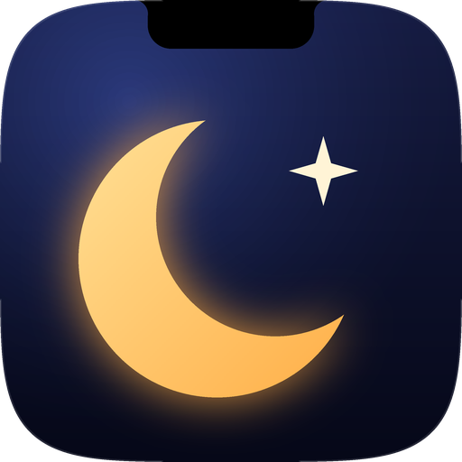
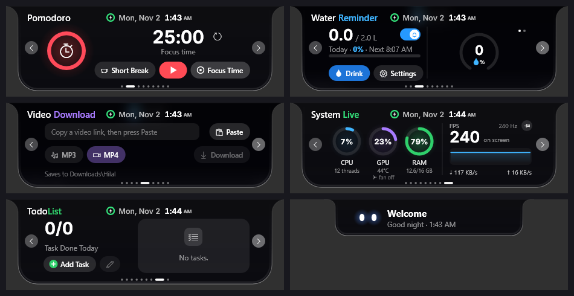

<p align="center">
  
</p>

<h1 align="center">Hilal</h1>

<p align="center">
  <b>A Dynamic Island–style notch for the top of your Windows screen.</b><br>
  Music, focus, reminders, prayer times, downloads, your Claude Code sessions and live system stats,
  in one small piece of Liquid Glass that opens when you hover it.
</p>

<p align="center">
  
</p>

---

## What it does

Hilal sits at the top center of the screen. Closed, it's a small pill (or just a thin line). Hover it
and it springs open into pages you flip through with the arrows, the dots, the mouse wheel or the
arrow keys.

**While closed** it shows the time (12- or 24-hour, following Windows), and whatever is going on:
the song playing, with bars that move with the actual sound in the cover's color, the current lyric
line, or a running focus timer. Reminders peek out on their own.

It comes in two styles, switched in Settings: **Classic Hilal**, described first below, and
**Nova**, which adds a lot more (see [Nova mode](#nova-mode)).

| Page | What's on it |
|---|---|
| **Music** | What's playing in any app that reports to Windows' media controls (Spotify, browsers, players): cover, title, progress, play/pause/skip, and **lyrics** in a wide view: synced, line by line with the song, or, when the lyrics library has only the words, those to read and scroll. |
| **Pomodoro** | Focus and short-break timers. |
| **Water Reminder** | A daily goal split into reminders through your waking hours; tracks your bottle and refills, with snooze. |
| **Prayer Times** | The five daily prayers for 33 Egyptian cities, worked out on the device with the Egyptian Survey's method (they match Google's and the Egyptian tables), a countdown to the next prayer, and an alert at each prayer that can play an **adhan recording of your choice**. |
| **Video Download** | Paste a link and download a video or its sound (YouTube and the many other sites yt-dlp supports). Before it starts, a small window lets you choose video or audio only, the format (MP4, MKV, WEBM, MP3, M4A, OPUS, WAV) and the quality (only what the video has), rename the file, and set the artist and album written into it. |
| **Claude Code** | Your recent [Claude Code](https://claude.com/claude-code) sessions: which are working, waiting for you, done or stopped, and their task progress. Click one for a glass popup with its tasks and latest exchange, and a box to send it a message (pasted into the Claude app, for you to send). |
| **Shelf** | Drop files onto the notch to keep them at hand; drag them back out. |
| **Todo** | A short task list with times. |
| **System** | CPU, GPU and RAM load, GPU temperature and **fan RPM**, the screen's real FPS, and network speed. |

## The look

- **Liquid Glass.** The notch blurs and tints whatever is behind it, live. It can be switched to
  solid black.
- **Smooth everywhere.** Spring animations, drawn at your monitor's refresh rate (240 Hz included).
- **Stays out of the way.** It hides in full-screen games and videos. Over maximized windows (a
  browser full of tabs, say) it can stay, shrink to a thin line that lets clicks through to the tabs
  below, or hide.
- **FPS overlay.** A small pinnable, draggable glass card with the on-screen FPS and load.
- **Screenshots work.** Print Screen and Win+Shift+S capture the notch like any other window.

## Settings

Open **Settings** from the tray menu (the most used switches are in the tray menu itself). Its
pages: **General** (the style, start with Windows, full screen and maximized windows, the look),
**Prayer**, and in Nova mode also **Alerts & Privacy**, **Island** (which pages show, what the
closed notch turns through), **Apps**, **Connections** (calendar, downloads), **Companion** and
**Themes**.

## Nova mode

Nova turns on everything that follows [Nova Island](https://github.com/NOVA-TECH-KIT/nova-island),
each part with its own switch. Classic Hilal stays exactly as it was, and Nova's own settings stay
saved when you switch back.

- **Prayer:** 44 cities around the world as well as Egypt's, or **wherever you are** (found from
  your internet address), each with its country's method (Umm al-Qura, Dubai, Diyanet, ISNA and
  more) and in the place's own time zone, like a mosque timetable. The Hijri date (adjustable by a
  day or two for a local moon sighting), Asr by the Hanafi rule, a short heads-up 10 minutes
  before, a Ramadan countdown to iftar and imsak, and the adhan as a card with the mascot.
- **Dhikr, du'a and Qur'an.** Every few minutes (5 by default) a card with a verse, a dhikr or a
  du'a comes out of the notch for half a minute, in the King Fahd Complex's Qur'an script, sized
  to its words. Resting the mouse on it holds it; none repeats until all 136 have been shown. Pick
  how often, for how long and which kinds, and set quiet hours.
- **The notch:** **drag it** anywhere (dropped near the top edge it docks there, snapping to the
  middle), stand it on the left or right edge as a slim capsule, or let it sit in the right third
  of Chrome, Edge or Brave's address bar. Closed, it turns between the clock and weather, CPU and
  memory, the next prayer and the next meeting. A card for each new song, 13 themes, and
  **Ctrl+Alt+H** pins it open from anywhere until you press it again.
- **Toasts:** volume, brightness, battery, keyboard language, Caps Lock, the internet, apps
  using the mic or camera (with a dot on the notch), copied screenshots (saved to
  `Pictures\Hilal` and put on the Shelf for a while), browser downloads, and a smart clipboard
  for links, colors and sums.
- **Pages:** Apps (pinned apps to start or bring to the front), Quran Radio (live stations from
  mp3quran.net), and Clipboard (the connection, who's using the mic and camera, and what you
  copied, kept in memory only). Any page can be switched off.
- **Meetings** from a private iCal link (Google, Outlook, iCloud): a toast before each, and Join.
- **Companion:** Welcome back (with what happened while you were away), a morning card, a break
  after 50 minutes, confetti, and eyes on the notch that follow the mouse.
- **Recordings and screen sharing:** while OBS or Streamlabs runs, the notch turns solid so it
  shows in the recording, and **Show in screen sharing** does the same for Discord and others.
- **And more:** a YouTube mini player, performance options (no animations, frozen glass, a
  battery saver), **auto-update** (Hilal offers new versions itself), and news from Hilal's
  GitHub page.

## Install

1. Download the newest **HilalSetup** from [the latest release](https://github.com/Mohamedemad27/hilal/releases/latest)
   (under **Assets**).
2. Run it and press **Install**, then **Launch Hilal**. It installs for your user only, with no
   admin rights, to `%LOCALAPPDATA%\Programs\Hilal`, and adds Hilal to the Start menu.

Windows SmartScreen may warn that the installer is from an unknown publisher (it isn't code-signed):
choose **More info**, then **Run anyway**. To build it yourself instead, see [Build](#build).

To update, install the new version over the old one: your settings stay. In Nova mode Hilal
checks for new versions itself and offers them on the notch.

### For the Video Download page

It needs two free tools that aren't bundled. Put them in a `tools` folder inside Hilal's folder, so
you end up with:

```
%LOCALAPPDATA%\Programs\Hilal\tools\yt-dlp.exe
%LOCALAPPDATA%\Programs\Hilal\tools\ffmpeg.exe
%LOCALAPPDATA%\Programs\Hilal\tools\ffprobe.exe
```

- **yt-dlp:** download [yt-dlp.exe](https://github.com/yt-dlp/yt-dlp/releases/latest/download/yt-dlp.exe)
  and put it there as is.
- **FFmpeg:** download [ffmpeg-release-essentials.zip](https://www.gyan.dev/ffmpeg/builds/ffmpeg-release-essentials.zip),
  open it, and copy `ffmpeg.exe` and `ffprobe.exe` from its `bin` folder.
- **[Node.js](https://nodejs.org/)** (optional): if it's installed, yt-dlp uses it to handle
  YouTube's checks, which keeps YouTube downloads working.

## Build

Hilal is written in Rust against the Windows APIs directly (Win32, Direct3D 11, Direct2D,
DirectWrite, DirectComposition, Desktop Duplication, WASAPI, UI Automation, WinRT media), with no UI
framework.

Requirements: Windows 10 (2004 or later) or Windows 11, and the Rust **GNU** toolchain (pinned in
`rust-toolchain.toml`; no Visual Studio needed). Build from PowerShell.

```powershell
git clone https://github.com/Mohamedemad27/hilal.git
cd hilal
cargo build --release     # target\release\hilal.exe
cargo test --release      # the unit tests
.\dist.ps1                # builds Hilal and its installer: dist\HilalSetup-<version>.exe
```

Get Rust from [rustup.rs](https://rustup.rs/). The project uses the toolchain named in
`rust-toolchain.toml`; if cargo doesn't fetch it on its own, run
`rustup toolchain install stable-x86_64-pc-windows-gnu`.

The `research` folder has the scripts used to test Hilal for real: driving the mouse, recording the
speakers, measuring frame timing and GPU use. Set `HILAL_FPS=<file>` to have Hilal log frame timing
and events there, and `HILAL_DUMP=<folder>` to save pictures of what it draws.

## Ideas and bugs

Have an idea for Hilal, or found something that doesn't work? Tell us, in English or Arabic:

- 💡 **[Suggest a feature](https://github.com/Mohamedemad27/hilal/issues/new?template=feature_request.yml)**
- 🐞 **[Report a bug](https://github.com/Mohamedemad27/hilal/issues/new?template=bug_report.yml)**

You'll need a (free) GitHub account. See what others have asked for in
[Issues](https://github.com/Mohamedemad27/hilal/issues), and add a 👍 to the ideas you'd like too.

## Privacy

Hilal keeps everything on your PC, in `%APPDATA%\Hilal`. There's no account and no telemetry. It
goes online only to fetch lyrics from [LRCLIB](https://lrclib.net) (the song's title, artist and
length), for downloads you start yourself, and, only if you pick **Auto** as the prayer city, once
a day to find your city from your internet address ([ipwho.is](https://ipwho.is), or if it's busy
[GeoJS](https://www.geojs.io) or [ipapi](https://ipapi.co)). In Nova mode it also reads the weather
from [Open-Meteo](https://open-meteo.com) (for the city found the same way), Quran Radio's stations from
[mp3quran.net](https://mp3quran.net), your iCal link if you give one, and Hilal's own GitHub page
(for updates and news); nothing is sent about you. The Claude Code page only reads the session
files Claude Code keeps on your PC.

## Credits

- [Inter](https://rsms.me/inter/) by Rasmus Andersson, under the SIL Open Font License
  (`assets/fonts/Inter-LICENSE.txt`).
- The [KFGQPC Hafs](https://fonts.qurancomplex.gov.sa/) Qur'an font by the King Fahd Glorious
  Quran Printing Complex, included unmodified under its own license
  (`assets/fonts/KFGQPC-LICENSE.txt`).
- The reminders' texts, the prayer methods by country and the way the notch moves and docks
  follow [Nova Island](https://github.com/NOVA-TECH-KIT/nova-island) by AmerTech, under the GPL v3.
- Lyrics by [LRCLIB](https://lrclib.net), the weather by [Open-Meteo](https://open-meteo.com), and
  Quran Radio's stations by [mp3quran.net](https://mp3quran.net).
- Downloads by [yt-dlp](https://github.com/yt-dlp/yt-dlp) and [FFmpeg](https://ffmpeg.org).
- GPU readings through NVIDIA's NVML.
- Inspired by [Nusa](https://rama2555.github.io/nusa/).
